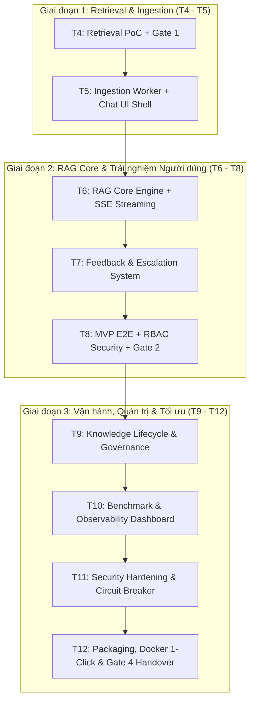
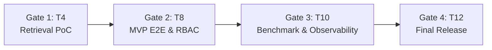

# MasterPro Copilot — Kế Hoạch Chi Tiết Triển Khai (T4 – T12)
**Hệ thống Trợ lý AI Thông minh Tra cứu & Hỗ trợ Nghiệp vụ ERP/POS MasterPro**

---

## 1. Tổng Quan Mục Tiêu & Kiến Trúc Dự Án (T4 – T12)

Kế hoạch này tiếp nối nền tảng đã hoàn thành:
- **Tuần 1 & 2**: Thiết kế Database, chuẩn hóa dữ liệu tiếng Việt (NFC, terminology), benchmark chunking baseline.
- **Tuần 3**: Hoàn thiện `HeadingAwareChunker` phân đoạn Markdown giữ nguyên cấu trúc tiêu đề, bảng, list, code block.

Giai đoạn **T4 – T12** tập trung đưa MasterPro Copilot từ PoC tìm kiếm ngữ nghĩa đến một sản phẩm hoàn chỉnh, an toàn, có khả năng mở rộng (production-ready).

---

## 2. Lộ Trình Chi Tiết Từng Tuần (Work Breakdown Structure)

### Tuần 4: Retrieval PoC & Gate 1 Build
* **Mục tiêu**: Chứng minh khả năng truy xuất đúng tài liệu kỹ thuật MasterPro bằng vector search với Qdrant trước khi tích hợp sinh ngôn ngữ LLM.

| Thành phần | Nhiệm vụ kỹ thuật chi tiết | Sản phẩm bàn giao (Deliverables) |
| :--- | :--- | :--- |
| **Backend** | - Tích hợp `qdrant-client` vào FastAPI. - Tạo API `/api/v1/search` nhận query, sinh vector và truy vấn Qdrant. - Bộ lọc metadata: `category`, `module`, `version`. | `app/services/qdrant_service.py` `app/api/routes/search.py` |
| **Frontend** | - Dựng khung vỏ ứng dụng (Shell UI): Sidebar chuyển tab Chat/Admin. - Màn hình thử nghiệm Search trực quan hiển thị Top-K kết quả kèm cosine score. | `src/components/layout/Shell.jsx` `src/pages/SearchPoCPage.jsx` |
| **AI / Data** | - Triển khai Qdrant (Docker/Cloud). - Tạo collection `masterpro_kb` (vector size: 1536 hoặc 1024, Cosine). - Chạy `HeadingAwareChunker` + Embed 50 tài liệu thực tế của MasterPro vào Qdrant. | `ai/qdrant_indexer.py` `ai/test_retrieval_benchmark.py` |
| **QA / BA** | - BA hoàn thiện tập dữ liệu 50 tài liệu gốc. - Tester xây dựng bộ 30 câu hỏi nghiệp vụ chuẩn (Ground Truth Query Set). | `docs/testing/ground_truth_30_queries.json` |

---

### Tuần 5: Ingestion Pipeline & Chat UI
* **Mục tiêu**: Tự động hóa quy trình nạp tài liệu từ file/database vào vector store và xây dựng giao diện hội thoại hoàn chỉnh.

| Thành phần | Nhiệm vụ kỹ thuật chi tiết | Sản phẩm bàn giao (Deliverables) |
| :--- | :--- | :--- |
| **Backend** | - Xây dựng Ingestion Worker: nhận tài liệu -> làm sạch -> `HeadingAwareChunker` -> Embedding -> Upsert Qdrant. - API upload file tài liệu (Markdown, DOCX, TXT) với cơ chế background task. | `app/services/ingestion_service.py` `app/api/routes/ingestion.py` |
| **Frontend** | - Hoàn thiện `ChatWindow`, `MessageBubble`, `InputBox` với tự động giãn nở (auto-resize). - Trạng thái đang tải (Typing indicator/Skeleton loading). | `src/components/chat/ChatWindow.jsx` `src/components/chat/MessageBubble.jsx` |
| **AI / Data** | - Thử nghiệm điều chỉnh siêu tham số: `chunk_size` (400 - 800), `chunk_overlap` (60 - 120), Top-K (3 - 6). - Đánh giá tỷ lệ mất ngữ cảnh khi chunk qua bảng biểu và danh sách bước. | `docs/reports/chunking_tuning_report.md` |
| **QA / BA** | - Kiểm thử tải luồng nạp hàng loạt 100 tài liệu. - Đo đạc thời gian xử lý trung bình trên mỗi trang tài liệu (< 1.5s/trang). | Kịch bản test upload & ingestion |

---

### Tuần 6: RAG Core Engine & SSE Streaming
* **Mục tiêu**: Hoàn thiện lõi RAG: kết hợp ngữ cảnh truy xuất với mô hình ngôn ngữ lớn (LLM), trả lời thời gian thực qua Server-Sent Events (SSE).

| Thành phần | Nhiệm vụ kỹ thuật chi tiết | Sản phẩm bàn giao (Deliverables) |
| :--- | :--- | :--- |
| **Backend** | - Triển khai RAG Core: Router query -> Hybrid Retrieval -> Context Assembly -> LLM Invocation. - Thiết lập ngưỡng lọc tương đồng (`Cosine Threshold ≥ 0.70`). - Endpoint streaming SSE: `/api/v1/chat/stream`. | `app/services/rag_engine.py` `app/api/routes/chat_stream.py` |
| **Frontend** | - Kết nối SSE streaming với `EventSource` hoặc `fetch` reader. - Render Markdown thời gian thực hỗ trợ Table, Code block, List. - Bảo mật XSS bằng thư viện `DOMPurify`. | `src/services/sse_client.js` `src/components/chat/MarkdownRenderer.jsx` |
| **AI / Data** | - Thiết kế Context-Only System Prompt: nghiêm cấm bịa đặt ngoài tài liệu. - Xây dựng Citation Validator: kiểm tra mọi tuyên bố có gắn kèm anchor nguồn `[cite: doc_id, page]`. | `ai/prompts/masterpro_rag_prompt.py` `ai/citation_validator.py` |
| **QA / BA** | - BA nghiệm thử 30 ca hỏi đáp thực tế về quy trình lỗi phần cứng POS. - Đánh giá tỷ lệ từ chối trả lời chính xác khi thông tin không có trong tài liệu (> 95%). | Báo cáo nghiệm thu RAG Core v1 |

---

### Tuần 7: Feedback Loop & Escalation System
* **Mục tiêu**: Người dùng có thể đánh giá câu trả lời và chuyển tiếp (escalate) câu hỏi vượt thẩm quyền AI đến chuyên viên hỗ trợ cấp 2.

| Thành phần | Nhiệm vụ kỹ thuật chi tiết | Sản phẩm bàn giao (Deliverables) |
| :--- | :--- | :--- |
| **Backend** | - API lưu đánh giá phản hồi: `/api/v1/feedback` (Like/Dislike, lý do: sai bước, thiếu thông tin, văn phong kém). - API tạo phiếu Escalation sang đội kỹ thuật: `/api/v1/escalation`. | `app/models/feedback.py` `app/api/routes/feedback.py` |
| **Frontend** | - Nút Like/Dislike dưới từng tin nhắn bot kèm form góp ý nhanh. - `CitationDrawer`: bảng trượt xem trích dẫn nguồn văn bản gốc khi bấm vào số trang. - `EscalationModal`: Popup chuyển tiếp câu hỏi lên bộ phận hỗ trợ kỹ thuật. | `src/components/chat/FeedbackAction.jsx` `src/components/chat/CitationDrawer.jsx` `src/components/chat/EscalationModal.jsx` |
| **AI / Data** | - Cơ chế Mock Provider phục vụ chạy test độc lập không phụ thuộc LLM bên ngoài. - Log lại context của các câu hỏi bị Dislike phục vụ tái huấn luyện / cập nhật tài liệu. | `ai/mock_llm_provider.py` |
| **QA / BA** | - Thử nghiệm toàn bộ luồng Escalation: tạo phiếu, lưu vết câu hỏi và context đi kèm. | Test script E2E Feedback & Ticket Escalation |

---

### Tuần 8: MVP E2E & Role-Based Access Control (RBAC)
* **Mục tiêu**: Hoàn thiện MVP khép kín với bảo mật phân quyền theo vai trò (Thu ngân, Quản lý cửa hàng, Quản trị hệ thống, Hỗ trợ kỹ thuật).

| Thành phần | Nhiệm vụ kỹ thuật chi tiết | Sản phẩm bàn giao (Deliverables) |
| :--- | :--- | :--- |
| **Backend** | - Tích hợp xác thực JWT trên tất cả endpoint bảo vệ. - Lọc ngữ cảnh truy xuất theo quyền hạn: Qdrant payload filter `role_access IN (user_roles)`. | `app/core/security.py` `app/api/deps.py` |
| **Frontend** | - Luồng đăng nhập, lưu token JWT an toàn trong bộ nhớ/HTTP-only cookie. - Ẩn/hiện tính năng và tài liệu theo vai trò người dùng (Cashier vs Admin). | `src/contexts/AuthContext.jsx` `src/routes/ProtectedRoute.jsx` |
| **AI / Data** | - Định dạng trích dẫn chuẩn hóa `[SRC-1]`, `[SRC-2]` liên kết trực tiếp với metadata chunk. - Kiểm tra phân quyền: đảm bảo Thu ngân không bao giờ truy xuất được tài liệu của Giám đốc/Kế toán. | `ai/citation_formatter.py` |
| **QA / BA** | - **Nghiệm thu Gate 2**: Test ma trận phân quyền trên 4 vai trò người dùng. | `docs/testing/gate2_rbac_matrix_test.xlsx` |

---

### Tuần 9: Knowledge Lifecycle & Governance
* **Mục tiêu**: Xây dựng cổng quản trị tri thức: tạo mới, phê duyệt, đánh dấu hết hiệu lực (superseded) và tái lập chỉ mục (re-index).

| Thành phần | Nhiệm vụ kỹ thuật chi tiết | Sản phẩm bàn giao (Deliverables) |
| :--- | :--- | :--- |
| **Backend** | - API quy trình phê duyệt: `POST /documents/submit`, `POST /documents/{id}/approve`, `POST /documents/{id}/deprecate`. - Tự động xóa hoặc vô hiệu hóa vector cũ trong Qdrant khi tài liệu bị cập nhật/thay thế. | `app/services/document_lifecycle_service.py` |
| **Frontend** | - Bảng quản trị tài liệu Admin: lọc theo trạng thái (`DRAFT`, `APPROVED`, `SUPERSEDED`). - Giao diện upload tài liệu mới và xem lịch sử các phiên bản tài liệu. | `src/pages/admin/DocumentManagementPage.jsx` `src/components/admin/VersionHistoryModal.jsx` |
| **AI / Data** | - Cơ chế Re-indexing không gián đoạn dịch vụ (Blue/Green Collection hoặc Collection Aliasing trong Qdrant). | `ai/reindex_manager.py` |
| **QA / BA** | - BA hoàn thiện tài liệu hướng dẫn sử dụng dành cho cán bộ quản trị tri thức. | `docs/manuals/Knowledge_Governance_User_Guide.md` |

---

### Tuần 10: Benchmark, Observability & Hallucination Analysis
* **Mục tiêu**: Đo lường định lượng toàn diện hệ thống: độ trễ, chi phí token, tỷ lệ hallucination và độ hài lòng của người dùng.

| Thành phần | Nhiệm vụ kỹ thuật chi tiết | Sản phẩm bàn giao (Deliverables) |
| :--- | :--- | :--- |
| **Backend** | - Audit Logger ghi nhận chi tiết mỗi phiên truy vấn: query, retrieval latency, LLM latency, input/output tokens, cost est. | `app/middleware/audit_logger.py` `app/models/audit_log.py` |
| **Frontend** | - Dashboard quản trị trực quan hóa số liệu: tổng truy vấn, tỷ lệ Like/Dislike, top module được hỏi nhiều nhất. | `src/pages/admin/AnalyticsDashboard.jsx` |
| **AI / Data** | - Chạy benchmark tự động trên bộ 100 câu hỏi nghiệp vụ chuẩn. - Đánh giá 3 chỉ số RAG Triad: **Context Relevance**, **Groundedness**, **Answer Relevance**. | `ai/benchmark_rag_triad.py` `docs/reports/benchmark_v1_report.md` |
| **QA / BA** | - Phân tích các ca trả lời sai/hallucination để điều chỉnh prompt hoặc bổ sung tài liệu gốc. | Báo cáo phân tích lỗi sai và đề xuất khắc phục |

---

### Tuần 11: Security Hardening & Resilience
* **Mục tiêu**: Gia cố bảo mật, che giấu dữ liệu nhạy cảm (PII/Secret) và xây dựng cơ chế ngắt mạch (Circuit Breaker) khi mất kết nối.

| Thành phần | Nhiệm vụ kỹ thuật chi tiết | Sản phẩm bàn giao (Deliverables) |
| :--- | :--- | :--- |
| **Backend** | - Data Masking: tự động che giấu CCCD, số điện thoại, mật khẩu, API key trước khi gửi sang LLM. - Circuit Breaker & Fallback: tự động chuyển sang thông báo bảo trì/fallback nếu LLM API quá tải hoặc hết quota. | `app/core/data_masking.py` `app/core/circuit_breaker.py` |
| **Frontend** | - Xử lý thông minh khi mất mạng hoặc đứt kết nối SSE (tự động thử lại có giãn cách Exponential Backoff). - Thông báo lỗi thân thiện khi hệ thống chạm ngưỡng giới hạn quota. | `src/components/common/NetworkBanner.jsx` |
| **AI / Data** | - Khóa cứng cấu hình Prompt Injection Protection (ngăn chặn jailbreak). - Đóng băng cấu hình retrieval tham số tối ưu đã nghiệm thu. | `ai/security/prompt_guard.py` |
| **QA / BA** | - Kiểm thử tấn công hộp đen: Prompt Injection, cố tình hỏi dữ liệu bảo mật, ngắt kết nối mạng bất ngờ. | Báo cáo kiểm thử an toàn & bảo mật |

---

### Tuần 12: Đóng Gói, Triển Khai Docker 1-Click & Bàn Giao
* **Mục tiêu**: Đóng gói toàn bộ giải pháp thành Docker Compose chạy 1 câu lệnh, nghiệm thu Gate 4 và bàn giao hoàn tất dự án.

| Thành phần | Nhiệm vụ kỹ thuật chi tiết | Sản phẩm bàn giao (Deliverables) |
| :--- | :--- | :--- |
| **Backend** | - Tối ưu Dockerfile nhiều giai đoạn (Multi-stage build). - Tệp `docker-compose.yml` tích hợp toàn bộ: Backend + Frontend + Qdrant + SQL Server. | `docker-compose.yml` `backend/Dockerfile` |
| **Frontend** | - Tối ưu hóa kích thước bundle (Tree-shaking, Code-splitting). - Kiểm tra hiển thị responsive trên máy tính thu ngân và thiết bị POS cầm tay. | `frontend/Dockerfile` `frontend/dist/` |
| **AI / Data** | - Kịch bản sao lưu & phục hồi vector index dự phòng khi gặp sự cố. - Tài liệu Hướng dẫn vận hành sự cố L1/L2 (Operational Runbook). | `ai/backup_qdrant.py` `docs/runbook/AI_Module_Runbook.md` |
| **QA / BA** | - **Nghiệm thu toàn diện Gate 4 (Final Release)**. - Bàn giao mã nguồn sạch, tài liệu hướng dẫn và video demo vận hành. | Biên bản nghiệm thu Gate 4 |

---

## 3. Khung Cổng Nghiệm Thu (Quality Gates Checklist)

### Chi Tiết Điều Kiện Tiên Quyết Từng Gate

| Cổng nghiệm thu | Thời điểm | Điều kiện tiên quyết (Exit Criteria / Definition of Done) | Trách nhiệm |
| :--- | :--- | :--- | :--- |
| **Gate 1: Retrieval PoC** | Cuối T4 | 1. 50 tài liệu MasterPro được chunk và index thành công vào Qdrant. 2. API `/search` phản hồi trong $\le 300\text{ms}$. 3. Độ chính xác Top-3 Retrieval trên 30 câu hỏi mẫu đạt $\ge 85\%$. 4. Không phát sinh lỗi Unicode tiếng Việt khi hiển thị kết quả. | AI Lead + Backend + Tester |
| **Gate 2: MVP E2E & RBAC** | Cuối T8 | 1. Luồng Chat hoàn chỉnh: Gửi câu hỏi -> SSE streaming -> Hiển thị Markdown + Citation. 2. Phân quyền dữ liệu theo vai trò (Thu ngân không xem được tài liệu mật). 3. Ngăn chặn bịa đặt (Hallucination) với ngưỡng lọc Cosine $\ge 0.70$. 4. Kiểm thử E2E 30 ca nghiệp vụ đạt tỷ lệ chấp thuận $\ge 90\%$. | Toàn đội + BA |
| **Gate 3: Benchmark & Observability** | Cuối T10 | 1. Hệ thống ghi log kiểm toán (Audit Log) đầy đủ chi phí token và độ trễ. 2. Đạt điểm số RAG Triad: Groundedness $\ge 90\%$, Relevance $\ge 88\%$. 3. Dashboard hiển thị số liệu trực quan không có độ trễ lớn. | AI Lead + Tester |
| **Gate 4: Final Handover** | Cuối T12 | 1. Khởi động 1 câu lệnh duy nhất: `docker-compose up -d` không phát sinh lỗi. 2. Toàn bộ Unit Test và Integration Test đều đạt trạng thái `PASSED` (100%). 3. Bộ tài liệu hoàn chỉnh: API Doc, User Manual, Admin Runbook, Kiến trúc hệ thống. | Toàn đội + Khách hàng / GVHD |

---

## 4. Hệ Thống Chỉ Số KPI & Mục Tiêu Định Lượng

| Nhóm chỉ số | Chỉ số cụ thể | Định nghĩa kỹ thuật | Ngưỡng cam kết (Target KPI) |
| :--- | :--- | :--- | :--- |
| **Retrieval Quality** | **Precision@3** | Tỷ lệ chunk thực sự liên quan trong Top-3 kết quả trả về | $\ge 85\%$ |
| | **MRR (Mean Reciprocal Rank)** | Vị trí xuất hiện của chunk chính xác đầu tiên | $\ge 0.80$ |
| **Generation & Trust** | **Groundedness / Faithfulness** | Tỷ lệ thông tin trong câu trả lời có bằng chứng xác thực từ tài liệu trích dẫn | $\ge 95\%$ |
| | **Hallucination Rate** | Tỷ lệ câu trả lời chứa thông tin sai lệch ngoài tài liệu | $< 3\%$ |
| | **Citation Precision** | Tỷ lệ trích dẫn đúng số trang/section của tài liệu gốc | $\ge 95\%$ |
| **Hiệu năng & Hệ thống** | **Retrieval Latency** | Thời gian vector search trên Qdrant | $< 250\text{ms}$ |
| | **Time-to-First-Token (TTFT)** | Thời gian từ khi gửi câu hỏi đến khi token đầu tiên hiển thị trên giao diện (SSE) | $< 1.2\text{s}$ |
| | **Test Coverage** | Tỷ lệ bao phủ kiểm thử tự động của codebase AI & Backend | $\ge 85\%$ |

---

## 5. Chiến Lược Quản Trị Rủi Ro & Dự Phòng (Risk Matrix)

| Rủi ro kỹ thuật | Mức độ | Hậu quả tiềm ẩn | Biện pháp phòng ngừa & Kịch bản khắc phục |
| :--- | :---: | :--- | :--- |
| **API LLM quá tải / Hết quota** | Cao | Hệ thống ngưng hoạt động, người dùng không nhận được phản hồi | - Triển khai Circuit Breaker tự động. - Fallback sang nhà cung cấp phụ (Azure OpenAI / Anthropic / Groq) hoặc hiển thị kết quả trích lục nguyên văn từ tài liệu kèm thông báo ngắn gọn. |
| **Qdrant Vector DB gặp sự cố** | Trung bình | Mất khả năng tìm kiếm ngữ nghĩa | - Lưu song song bản sao vector offline (`vector_index.json` dự phòng tuần 2). - Tự động fallback sang thuật toán tìm kiếm kết hợp TF-IDF + BM25 trên SQL Server. |
| **Mất kết nối mạng tại quầy POS** | Cao | Giao diện hội thoại bị treo khi đang streaming | - SSE client tự động thử kết nối lại với cơ chế Exponential Backoff. - Lưu tạm hội thoại cục bộ vào `localStorage` / `IndexedDB` của trình duyệt. |
| **Prompt Injection từ người dùng** | Trung bình | Tiết lộ system prompt hoặc thông tin phân quyền nội bộ | - Lọc dữ liệu đầu vào qua lớp bảo vệ `PromptGuard`. - Tách biệt ranh giới giữa System Instructions và User Query bằng ký tự phân cách an toàn. |

---

## 6. Sẵn Sàng Triển Khai Tuần 4 (Next Steps)

Tài liệu kế hoạch chi tiết đã được lưu trữ vĩnh viễn tại:
👉 [docs/masterpro_copilot_roadmap_t4_t12.md](file:///e:/thuc%20tap/masterpro-copilot/docs/masterpro_copilot_roadmap_t4_t12.md)

Với kế hoạch đã được chuẩn hóa và các tiêu chí nghiệm thu rõ ràng, bước hành động tiếp theo là khởi động **Tuần 4 (T4 - Retrieval PoC)**:
1. Cấu hình container **Qdrant** và khởi tạo collection vector cho MasterPro.
2. Nạp và nhúng 50 tài liệu nghiệp vụ mẫu bằng `HeadingAwareChunker` đã hoàn thiện ở Tuần 3.
3. Xây dựng endpoint `/api/v1/search` và bộ kiểm thử tự động 30 câu hỏi để nghiệm thu **Gate 1**.
